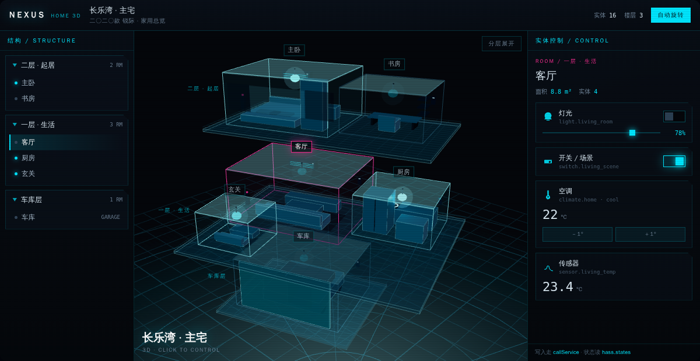

# NEXUS Home 3D

赛博朋克风格的三维家宅总览卡片，给 Home Assistant Lovelace 用。三层楼叠在一起、会自动旋转，点房间就能控制它的灯、开关、空调、窗帘和车库门。楼层和房间在可视化编辑器里随便加删。



## 特性

- **单文件 js**：`nexus-home-3d.js` 约 500KB，three.js 已经打进去了，没有运行时依赖。
- **结构即配置**：楼层 / 房间 / 尺寸 / 实体全在一份 YAML 里，加一层楼不用改代码。
- **玻璃房间**：墙是全息玻璃，能直接看到屋里的床、沙发、灶台、车；轮廓用霓虹描边。
- **点模型就控制**：点吊灯直接开关、点窗帘开合、点车库门升降，右侧面板同步高亮对应实体。
- **灯亮有光**：房间自发光与吊灯光晕跟灯的亮度走，窗帘随 `cover` 位置收放。
- **自动降级**：环境不支持 WebGL 时保留完整的列表式控制，不会白屏。
- **容器自适应**：卡片被塞进窄分栏（< 900px）会自动改成上下布局。

## 安装

### 通过市场（推荐）

1. 市场里添加自定义仓库 `RockJesus/nexus-home-3d`，类型选 **Dashboard**。
2. 安装后在仪表盘添加卡片，搜索「NEXUS Home 3D」。

### 手动

1. 把 `nexus-home-3d.js` 放到 `/config/www/community/nexus-home-3d/`。
2. 设置 → 仪表盘 → 资源，添加 `/local/community/nexus-home-3d/nexus-home-3d.js`，类型 **JavaScript Module**。
3. 刷新页面（App 端需要杀掉进程重开）。

> 同一份 js 只能注册一条资源，CDN 与本地不要同时加，否则会 `already defined`。

## 最小配置

```yaml
type: custom:nexus-home-3d
title: 我的家
floors:
  - id: f1
    name: 一层
    level: 0
    rooms:
      - id: living
        name: 客厅
        size: l
        entities:
          light: light.living_room
```

## 完整配置

```yaml
type: custom:nexus-home-3d
title: 长乐湾 · 主宅
subtitle: 家用总览
height: 560                 # 卡片高度，默认 560
theme:
  accent: "#00E7FF"         # 主霓虹
  alert: "#FF2D95"          # 选中 / 告警
  scanlines: true           # 扫描线
camera:
  auto_rotate: true
  speed: 0.0045             # 每帧旋转弧度
floors:
  - id: f2
    name: 二层 · 起居
    level: 1                # 数字越大越靠上，楼层高度按这个排
    rooms:
      - id: master
        name: 主卧
        size: l             # s / m / l / xl，或直接写 [宽, 深]（米）
        entities:
          light: light.master_bedroom
          climate: climate.master_ac
          cover: cover.master_curtain
          sensor: sensor.master_temp
  - id: f1
    name: 一层 · 生活
    level: 0
    rooms:
      - id: living
        name: 客厅
        size: xl
        entities:
          light: light.living_room
          switch: switch.living_scene
          climate: climate.home
  - id: g0
    name: 车库层
    level: -1
    rooms:
      - id: garage
        name: 车库
        kind: garage        # 带升降门的体块
        size: xl
        entities:
          cover: cover.garage_door
          light: light.garage
          switch: switch.ev_charger
```

## 房间类型（决定屋里摆什么）

`kind` 写这八种之一，家具与装置会自动长出来；不写就按房间名字猜。

| kind | 屋里有什么 |
|---|---|
| `bedroom` 卧室 | 床、床头板、枕头、床头柜、衣柜 |
| `living` 客厅 | 沙发、茶几、电视柜、地毯 |
| `kitchen` 厨房 | 灶台、灶眼、冰箱、岛台 |
| `dining` 餐厅 | 餐桌 + 两把椅子 |
| `study` 书房 | 书桌、椅子、书架 |
| `bath` 卫生间 | 浴缸、洗手台 |
| `garage` 车库 | 低模整车 + 升降门（门板随 `cover` 开合） |
| `room` 通用 | 按客厅处理 |

家具高度会按房间净高自动收一点，不会顶穿玻璃盒。实体装置（吊灯、开关面板、壁挂空调、窗户+窗帘、传感器柱）按你绑定的槽位生成。

## 实体槽位

每个房间最多五个槽位，按域自动决定能做什么：

| 槽位 | 支持域 | 面板表现 |
|---|---|---|
| `light` | `light` | 开关 + 亮度滑杆，体块跟着发光 |
| `switch` | `switch` / `input_boolean` / `script` | 开关 |
| `climate` | `climate` | 当前温度 + ±1° |
| `cover` | `cover` | 关闭 / 半开 / 全开，车库门板同步升降 |
| `sensor` | `sensor` / `binary_sensor` | 只读数值 |

实体改名或删除后，面板会显示「实体缺失」，不会变成空白。

## 可视化编辑器

卡片右上角「编辑」进入可视化面板：

- 楼层：名称、序号、删除整层。
- 房间：名称、尺寸档位、类型（房间 / 车库）、五个实体槽位（HA 里存在 `ha-entity-picker` 时自动升级成实体选择器，否则是文本输入）。
- 房间位置不用管：按尺寸自动排布，超宽自动换行。

## 尺寸与高度

| 档位 | 平面（米） | 体块高度 |
|---|---|---|
| `s` | 1.6 × 1.4 | 0.95 |
| `m` | 2.2 × 1.9 | 1.18 |
| `l` | 3.0 × 2.4 | 1.40 |
| `xl` | 3.4 × 2.6 | 1.62 |

高度按面积分档，是为了让后排的大房间不被前排的小房间挡住。也可以直接写 `size: [2.6, 2.0]` 自定义平面。

## 开发

```bash
npm install
npm run dev      # 带 sourcemap 打包
npm run lint     # ESLint
npm run build    # 压缩打包到 nexus-home-3d.js
```

发布前对产物做确定性断言（无 BOM、纯 ESM、注册串齐全、版本一致）：

```bash
python3 check_card_bundle.py nexus-home-3d.js --version 1.0.0 \
  --card nexus-home-3d --editor nexus-home-3d-editor
```

版本号规则：三段十进制逐位递增，段内每位 ≤ 9，`1.0.9` 之后是 `1.1.0`。

## 已知限制

- 3D 画面依赖 WebGL；不支持时自动降级为列表模式，功能不减、只是没有立体图。
- 卡片一次只渲染一栋房子（多个楼栋请拆成多张卡片）。
- 场景里点亮房间的室内光源上限 14 盏，再多会为了帧率跳过新光源。
- 手机 App 有强缓存，换版本后需要杀掉进程重开才拿得到新 js。

## License

MIT
